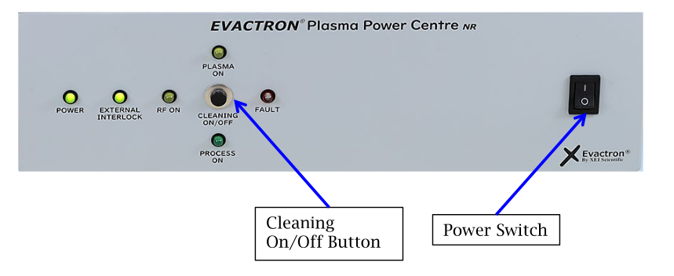
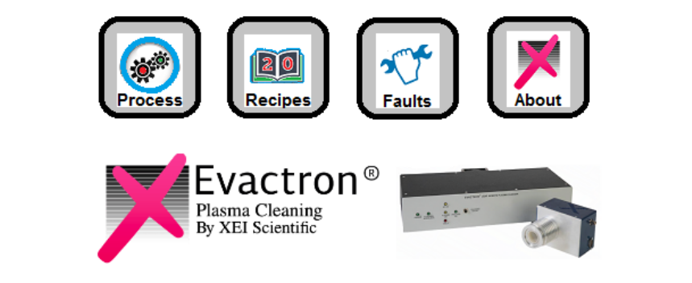
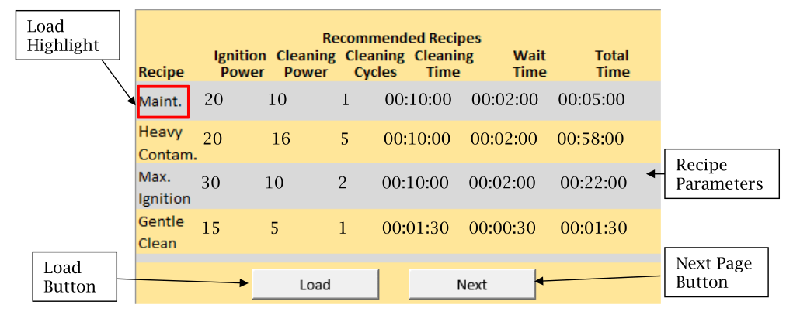
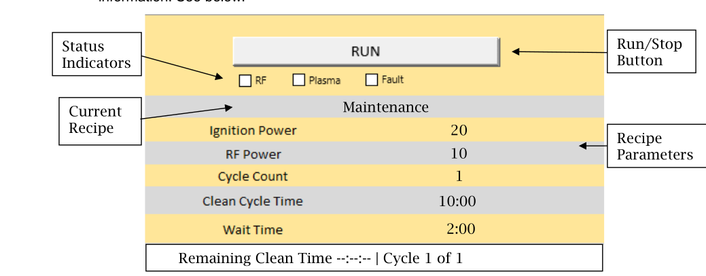

# XEI Evactron E16 Plasma Cleaner 

## Instrument Description
The XEI plasma cleaner has the following hardware components:
1. Dry scroll pump (in the cabinet under the plasma cleaner).
2. Touch screen display (in front of plasma cleaner, on the benchtop ).
3. Thyracont Pirani Gauge (mounted to the back of the plasma cleaner chamber).
4. Metal rack for sample mounting. 

### Front panel description

The function of each item is as follows:
- Power LED: Indicates the power status of the Evactron® E16
- External Interlock: Indicates the external interlock state. 
- RF On LED: Indicates the RF power On/Off status
- Plasma On LED: Indicates plasma Ignited/On/Off status
- Process On LED: Indicates a cleaning process is running
- Cleaning On/Off Button: Starts or Stops a cleaning sequence
- Power Switch: Switches On/Off the AC line voltage to the controller
- Fault LED: Fault in the RF circuit or RF cable continuity when lit
. 
## Quick workflow

### Venting Chamber
1. Power off the scroll pump using the toggle switch in the cabinet below the XEI plasma cleaner. 
2. Gently open the swagelok vent valve connected to the plasma cleaner. 
3. Wait for the pressure to reach 760 Torr. It takes about 1 additional minute for the system to truly vent. 
4. Once the chamber has vented and you can open the lid, close this vent valve. 

### Loading samples
1. If you are using a JEOL or FEI holder, remove the appropriate plug from the plasma cleaner chamber. Keep this plug safely. Then insert the TEM holder into the appropriate port until it reaches a physical stop. 
2. If you are using a "bulk specimen" such as a SEM stage, do not remove the plugs for TEM holders. Instead, lift up the lid of the plasma cleaner and insert the sample in the chamber. You can use the metal rack to mount your sample if needed. 

### Pumping Down
1. Make sure the vent swagelok valve is closed. 
2. Make sure every port is sealed with either a TEM holder, or a plug. 
3. Close the lid of the plasma cleaner. 
4. Turn on the toggle switch to power up the scroll pump in the cabinet under the plasma cleaner. 
5. Wait for pressure to drop to 400mTorr. 

### Executing a plasma cleaning recipe
1. Make sure the plasma controller is powered on. . 
2. Once the chamber is pumped down to 400mTorr, on the touchpanel, navigate to the home screen, which looks like 
3. You can open the process page to configure your process manually, but it is more convenient to load a pre-existing recipe. 
4. If you load a pre-configured recipe, you will see the following:
The highlighted recipe is the currently selected recipe. Choose the recipe you want to execute, and press the "Load" button. 
5. Operation is then switched to the Process display with the new recipe that has been
selected included and ready for execution, where you can press the run button. 
6. Once the recipe is completed, follow the protocol to vent the chamber. 
7. Remove your sample or TEM holder from the chamber. 
8. Re-insert all plugs into the chamber, and follow the process to pump down the chamber. 
